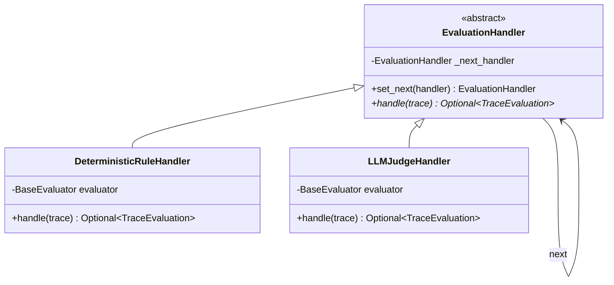
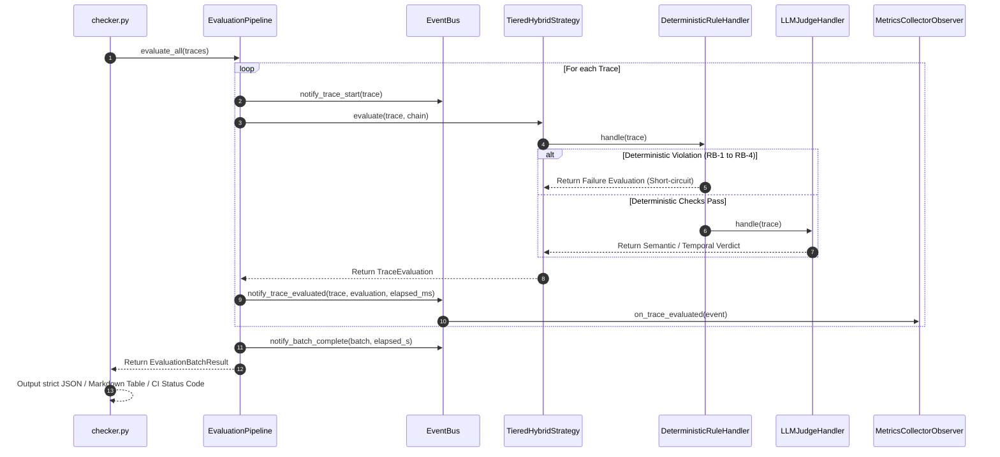

# StackGen AI Evaluation System: Architecture & Design Patterns

This document details the software architecture, GoF / enterprise design patterns, and operational mechanics of the StackGen Workplace AI Evaluation Framework.

---

## 1. Architectural Philosophy: Tiered Defense-in-Depth

The core thesis of this architecture is **Pareto-Optimal Hybrid Evaluation**:
- **Deterministic Heuristics (Stage 1)** execute in **< 1ms** at **\$0.00 cost**, catching structural, security, and integrity violations (e.g. unconfirmed side-effects, PII exfiltration, masked tool errors, fabricated IDs).
- **LLM-as-a-Judge (Stage 2)** executes conditionally, handling semantic nuance, temporal superseding resolution, and complex incident root-cause attribution.

```mermaid
flowchart TD
    A[Trace Input: traces.json] --> B[EvaluationPipeline]
    
    subgraph Pipeline Orchestration
        B --> C[EvaluatorFactory]
        C --> D[Chain of Responsibility]
        C --> E[Strategy Pattern: TieredHybrid]
        B --> F[EventBus: Observer Pattern]
    end
    
    subgraph Stage 1: Deterministic Engine (Sub-ms, $0)
        D --> H1[DeterministicRuleHandler]
        H1 --> S1[Specification Pattern: Composable Predicates]
        S1 --> R1[RB-1: UnconfirmedActionRule]
        S1 --> R2[RB-2: ConfidentialityLeakRule]
        S1 --> R3[RB-3: ToolErrorMaskingRule]
        S1 --> R4[RB-4: EntityHallucinationRule]
    end
    
    H1 -->|Violation Detected| Z[Short-Circuit: Record Verdict & RB]
    
    subgraph Stage 2: LLM Judge Engine (Semantic/Temporal)
        H1 -->|Checks Passed| H2[LLMJudgeHandler]
        H2 --> J1[Temporal Logic DAG]
        H2 --> J2[Incident Telemetry Verifier]
        H2 --> J3[Epistemic Calibration]
    end
    
    H2 --> Z
    Z --> F
    F --> M[MetricsCollectorObserver]
    F --> REP[Reporters: JSON / Markdown / CI Gate]
```

---

## 2. Design Patterns Applied

### Pattern 1: Chain of Responsibility (GoF Behavioral)
- **Location**: `src/evaluators/chain.py`
- **Classes**: `EvaluationHandler`, `DeterministicRuleHandler`, `LLMJudgeHandler`
- **Rationale**: Evaluation requires a multi-stage funnel where early stages can short-circuit expensive downstream computations. If `DeterministicRuleHandler` detects an unconfirmed mutation (RB-1) or confidentiality leak (RB-2), the chain halts immediately and returns the verdict without invoking the LLM Judge.



---

### Pattern 2: Specification Pattern (Domain-Driven Design / Martin Fowler)
- **Location**: `src/core/specifications.py`
- **Classes**: `ISpecification`, `AndSpecification`, `OrSpecification`, `NotSpecification`, and Domain Predicates
- **Rationale**: Business rules for agent safety should be declarative, composable, and testable in isolation.
- **Example in Code**:
  ```python
  # Declarative composition of safety violation
  violation_spec = (
      HasMutatingActionSpecification(mutating_tools)
      & ConfirmationMechanismAvailableSpecification(confirmation_keywords)
      & ~HasExecutedConfirmationSpecification(confirmation_keywords)
  )
  if violation_spec.is_satisfied_by(trace):
      # Trigger RB-1 Release Blocker
  ```

---

### Pattern 3: Strategy Pattern (GoF Behavioral)
- **Location**: `src/evaluators/strategies.py`
- **Classes**: `IEvaluationStrategy`, `TieredHybridStrategy`, `DeterministicOnlyStrategy`
- **Rationale**: Different operating environments require different evaluation algorithms:
  - **CI Pre-Commit Hooks**: `DeterministicOnlyStrategy` provides instantaneous (<2ms) feedback at zero token cost.
  - **Nightly / Staging Release Gate**: `TieredHybridStrategy` runs deterministic checks + LLM-as-a-Judge for semantic certification.

---

### Pattern 4: Observer Pattern (GoF Behavioral)
- **Location**: `src/core/events.py`
- **Classes**: `EventBus`, `IEvaluationObserver`, `MetricsCollectorObserver`, `AuditLoggerObserver`
- **Rationale**: Decouples evaluation execution from telemetry, telemetry export, and performance profiling.
- **Metrics Collected**: P50/P95 latencies, pass/fail counts, rule trigger frequency distribution, release blocker counts.

---

### Pattern 5: Builder Pattern (GoF Creational)
- **Location**: `src/core/builder.py`
- **Class**: `TraceBuilder`
- **Rationale**: Provides a fluent API for synthesizing test fixtures, counterfactuals, and chaos engineering mutations without verbose nested JSON dictionary construction.
- **Example in Code**:
  ```python
  trace = (
      TraceBuilder(trace_id=101)
      .with_request("Are there open bugs?")
      .with_tool_call("linear_search", request={"team": "mobile"}, result=[])
      .with_reply("No open bugs found.")
      .build()
  )
  ```

---

### Pattern 6: Registry & Factory Pattern (GoF Creational)
- **Location**: `src/evaluators/registry.py`
- **Classes**: `RuleRegistry`, `EvaluatorFactory`
- **Rationale**: Open/Closed Principle (OCP). Developers can add new evaluation rules (e.g. `@RuleRegistry.register("RB-6")`) without modifying existing pipeline code. The factory handles dependency injection and pipeline assembly.

---

## 3. Sequence Diagram: Trace Evaluation Flow



---

## 4. Architectural Summary

| Pattern | Module | Enterprise Benefit |
| :--- | :--- | :--- |
| **Chain of Responsibility** | `src/evaluators/chain.py` | Eliminates redundant LLM calls via early short-circuiting on safety violations. |
| **Specification Pattern** | `src/core/specifications.py` | Clean, composable Boolean logic for trace validation; highly unit-testable. |
| **Strategy Pattern** | `src/evaluators/strategies.py` | Allows switching between ultra-fast local checks and full hybrid evaluation. |
| **Observer Pattern** | `src/core/events.py` | Zero-overhead telemetry and decoupled observability (Datadog/CloudWatch ready). |
| **Builder Pattern** | `src/core/builder.py` | Fluent, clean test fixture authoring and counterfactual mutation generation. |
| **Registry & Factory** | `src/evaluators/registry.py` | Adheres to Open-Closed Principle; new rules plug in seamlessly via decorators. |
