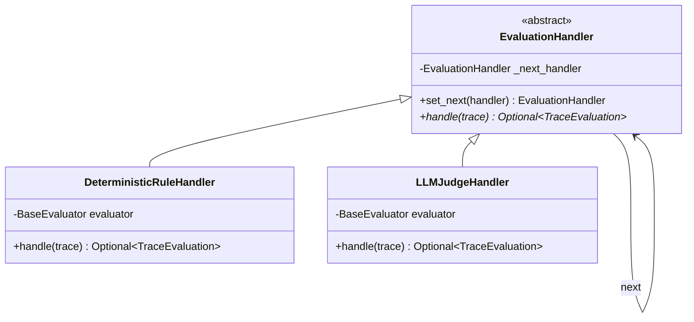
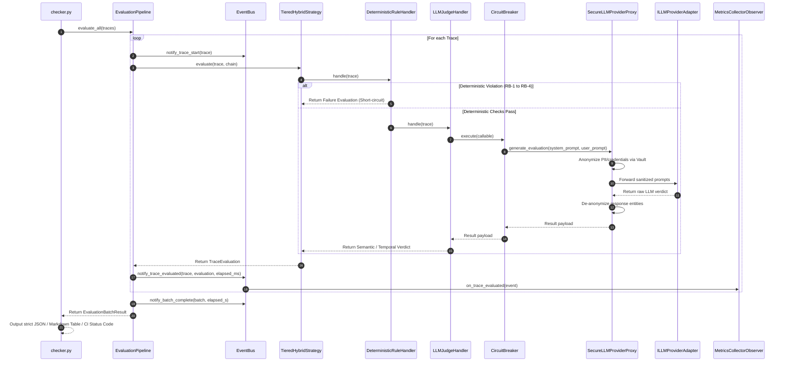

# StackGen AI Evaluation System: Architecture & Design Patterns

This document details the software architecture, design patterns, and operational mechanics of the StackGen Workplace AI Evaluation Framework.

---

## 1. Architectural Philosophy: Tiered Defense-in-Depth & Extreme Modular Decoupling

The core thesis of this architecture is **Pareto-Optimal Hybrid Evaluation**:
- **Deterministic Heuristics (Stage 1)** execute in **< 1ms** at **$0.00 cost**, catching structural, security, and integrity violations (e.g. unconfirmed side-effects, PII exfiltration, masked tool errors, fabricated IDs).
- **LLM-as-a-Judge (Stage 2)** executes conditionally, handling semantic nuance, temporal superseding resolution, and complex incident root-cause attribution.

### Architectural Discipline: 100% Class-Based, One-Class-Per-File (AST Enforced)
To enforce strict enterprise separation of concerns, the entire repository adheres to an uncompromising architectural rule:
1. **Exactly ONE Class per `.py` File**: Every single component, enum, rule, event, visitor, adapter, proxy, template, and memento resides in its own isolated file.
2. **Zero Isolated Functions**: No standalone module-level helper functions exist in the repository; every behavior is an encapsulated method of a class.
3. **Automated AST Gate**: Verified in CI through Python's `ast` parser across all 108 source and test modules.

```mermaid
flowchart TD
    A[Trace Input: traces.json] --> B[EvaluationPipeline]
    
    subgraph Pipeline Orchestration
        B --> C[EvaluatorFactory]
        C --> D[Chain of Responsibility]
        C --> E[Strategy Pattern: TieredHybrid]
        B --> F[EventBus: Observer Pattern]
        B --> MEM[Memento Pattern: TraceOriginator & Caretaker]
    end
    
    subgraph Stage 1: Deterministic Engine (Sub-ms, $0)
        D --> H1[DeterministicRuleHandler]
        H1 --> T1[Template Method: AbstractEvaluationTemplate]
        T1 --> S1[Specification Pattern: Composable Predicates]
        S1 --> R1[RB-1: UnconfirmedActionRule]
        S1 --> R2[RB-2: ConfidentialityLeakRule]
        S1 --> R3[RB-3: ToolErrorMaskingRule]
        S1 --> R4[RB-4: EntityHallucinationRule]
    end
    
    H1 -->|Violation Detected| Z[Short-Circuit: Record Verdict & RB]
    
    subgraph Stage 2: LLM Judge Engine & Resilience
        H1 -->|Checks Passed| H2[LLMJudgeHandler]
        H2 --> CB[Circuit Breaker: CLOSED/OPEN/HALF-OPEN]
        CB --> PRX[Proxy Pattern: SecureLLMProviderProxy / DLP Vault]
        PRX --> AD[ILLMProviderAdapter: OpenAI / Anthropic / Mock]
        H2 --> J1[Temporal Logic DAG]
        H2 --> J2[Incident Telemetry Verifier]
        H2 --> J3[Epistemic Calibration]
    end
    
    H2 --> Z
    Z --> F
    F --> M[MetricsCollectorObserver]
    Z --> VIS[Visitor Pattern: JUnitXML / AuditTrail]
    F --> REP[Reporters: JSON / Markdown / CI Gate]
```

---

## 2. Comprehensive Catalog of Design Patterns (13 Implemented Patterns)

The system implements 13 enterprise design patterns across GoF, Fowler, and Enterprise Resilience catalogs:

### Pattern 1: Chain of Responsibility (GoF Behavioral)
- **Directory**: `src/evaluators/chain/`
- **Classes**: `EvaluationHandler`, `DeterministicRuleHandler`, `LLMJudgeHandler`
- **Rationale**: Evaluation requires a multi-stage funnel where early stages can short-circuit expensive downstream computations. If `DeterministicRuleHandler` detects an unconfirmed mutation (RB-1) or confidentiality leak (RB-2), the chain halts immediately and returns the verdict without invoking the LLM Judge.



---

### Pattern 2: Circuit Breaker Pattern (Enterprise Resilience / Nygard)
- **Directory**: `src/resilience/`
- **Classes**: `CircuitBreaker`, `CircuitState`, `CircuitBreakerOpenException`
- **Rationale**: Protects the evaluation pipeline against external LLM provider outages, rate-limits (HTTP 429), and cascading latency degradation.
- **State Machine**:
  - `CLOSED`: Normal operation. Tracks consecutive failures.
  - `OPEN`: Tripped after `failure_threshold` consecutive exceptions. Fails fast with `CircuitBreakerOpenException` without hitting the network.
  - `HALF_OPEN`: Entered after `recovery_timeout_seconds`. Allows trial probe calls. If successful, resets to `CLOSED`; if failing, reverts to `OPEN`.

---

### Pattern 3: Adapter Pattern (GoF Structural)
- **Directory**: `src/adapters/`
- **Classes**: `ILLMProviderAdapter`, `OpenAIProviderAdapter`, `AnthropicProviderAdapter`, `MockLLMProviderAdapter`, `LLMProviderFactory`
- **Rationale**: Translates disparate external LLM APIs (OpenAI Chat Completions, Anthropic Messages) into a unified internal judge interface. Enables 100% offline, deterministic testing with `MockLLMProviderAdapter` while supporting seamless production deployment to frontier models via environment variables.

---

### Pattern 4: Decorator Pattern (GoF Structural)
- **Directory**: `src/decorators/`
- **Classes**: `EvaluatorDecorator`, `CachedEvaluatorDecorator`, `RetryWithBackoffDecorator`
- **Rationale**: Dynamically attaches cross-cutting operational capabilities to any evaluator without altering core evaluation logic:
  - `CachedEvaluatorDecorator`: MD5-based trace payload caching preventing redundant evaluations and slashing token costs.
  - `RetryWithBackoffDecorator`: Exponential backoff resilience against transient network/API glitches.

---

### Pattern 5: Visitor Pattern (GoF Behavioral)
- **Directory**: `src/visitors/`
- **Classes**: `IEvaluationVisitor`, `JUnitXMLVisitor`, `AuditTrailVisitor`
- **Rationale**: Decouples new export, reporting, and serialization operations from the underlying evaluation data structures.
  - `JUnitXMLVisitor`: Transforms `EvaluationBatchResult` into standard JUnit XML test reports for Jenkins, GitLab CI, and GitHub Actions test summary tabs.
  - `AuditTrailVisitor`: Generates timestamped, legally auditable compliance markdown reports detailing every rule trigger and driving evidence fact.

---

### Pattern 6: Memento Pattern (GoF Behavioral)
- **Directory**: `src/memento/`
- **Classes**: `TraceMemento`, `TraceOriginator`, `TraceCaretaker`
- **Rationale**: Provides immutable checkpointing, rollback, and counterfactual branch evaluation. In live reviews and chaos testing, agents can be subjected to synthetic mutations (e.g. injecting confirmation tools or redacting confidential fields) and then cleanly rolled back to pristine state without re-parsing raw JSON fixtures.

---

### Pattern 7: Template Method Pattern (GoF Behavioral)
- **Directory**: `src/templates/`
- **Classes**: `AbstractEvaluationTemplate`, `TemplatedDeterministicEvaluator`, `TemplatedLLMJudgeEvaluator`
- **Rationale**: Enforces a strict invariant lifecycle skeleton for all evaluators:
  1. Input validation & structural sanity checks
  2. Pre-evaluation hooks (prompt trimming/sanitization)
  3. Primitive execution (`_do_evaluate`) implemented by concrete evaluators
  4. Post-verdict normalization (e.g., ensuring passing traces never carry release blockers)
  5. Post-evaluation telemetry & audit logging

---

### Pattern 8: Proxy Pattern (GoF Structural)
- **Directory**: `src/proxies/`
- **Classes**: `SecureLLMProviderProxy`, `AnonymizationVault`
- **Rationale**: Enterprise Data Loss Prevention (DLP). Wraps any `ILLMProviderAdapter` to scrub sensitive PII (names, internal emails, credentials) via `AnonymizationVault` before prompts cross the network boundary to third-party LLMs, and transparently de-tokenizes the returning verdict for coherent internal auditing.

---

### Pattern 9: Specification Pattern (Domain-Driven Design / Fowler)
- **Directory**: `src/core/specifications/`
- **Classes**: `ISpecification`, `AndSpecification`, `OrSpecification`, `NotSpecification`, and Domain Predicates
- **Rationale**: Business rules for agent safety should be declarative, composable, and testable in isolation.
- **Example**:
  ```python
  violation_spec = (
      HasMutatingActionSpecification(mutating_tools)
      & ConfirmationMechanismAvailableSpecification(confirmation_keywords)
      & ~HasExecutedConfirmationSpecification(confirmation_keywords)
  )
  if violation_spec.is_satisfied_by(trace):
      # Trigger RB-1 Release Blocker
  ```

---

### Pattern 10: Strategy Pattern (GoF Behavioral)
- **Directory**: `src/evaluators/strategies/`
- **Classes**: `IEvaluationStrategy`, `TieredHybridStrategy`, `DeterministicOnlyStrategy`
- **Rationale**: Different operating environments require different evaluation algorithms:
  - **CI Pre-Commit Hooks**: `DeterministicOnlyStrategy` provides instantaneous (<2ms) feedback at zero token cost.
  - **Nightly / Staging Release Gate**: `TieredHybridStrategy` runs deterministic checks + LLM-as-a-Judge for semantic certification.

---

### Pattern 11: Observer Pattern (GoF Behavioral)
- **Directory**: `src/core/events/`
- **Classes**: `EventBus`, `IEvaluationObserver`, `MetricsCollectorObserver`, `AuditLoggerObserver`
- **Rationale**: Decouples evaluation execution from telemetry, monitoring, and profiling.
- **Metrics Collected**: P50/P95 latencies, pass/fail counts, rule trigger frequency distribution, release blocker counts.

---

### Pattern 12: Builder Pattern (GoF Creational)
- **Directory**: `src/core/builder/`
- **Class**: `TraceBuilder`
- **Rationale**: Provides a fluent API for synthesizing test fixtures, counterfactuals, and chaos engineering mutations without verbose nested JSON dictionary construction.

---

### Pattern 13: Registry & Factory Pattern (GoF Creational)
- **Directory**: `src/evaluators/registry/`, `src/evaluators/factory/`, `src/adapters/llm_provider_factory.py`
- **Classes**: `RuleRegistry`, `EvaluatorFactory`, `LLMProviderFactory`
- **Rationale**: Adheres to the Open/Closed Principle (OCP). Developers can add new evaluation rules (e.g. `@RuleRegistry.register("RB-6")`) without modifying existing pipeline code. The factory handles dependency injection and pipeline assembly.

---

## 3. Sequence Diagram: Trace Evaluation Flow



---

## 4. Architectural Summary Table

| Pattern | Package Directory | Enterprise Responsibility & Benefit |
| :--- | :--- | :--- |
| **Chain of Responsibility** | `src/evaluators/chain/` | Eliminates redundant LLM calls via early short-circuiting on safety violations. |
| **Circuit Breaker** | `src/resilience/` | Prevents cascading failures & catastrophic hanging when external LLMs degrade. |
| **Adapter Pattern** | `src/adapters/` | Unifies multi-cloud LLM providers (OpenAI, Anthropic, Mock) behind a single interface. |
| **Decorator Pattern** | `src/decorators/` | Adds zero-overhead caching and exponential retry backoff transparently. |
| **Visitor Pattern** | `src/visitors/` | Generates alternate output formats (JUnit XML, Compliance Audit Logs) cleanly. |
| **Memento Pattern** | `src/memento/` | Provides snapshotting, rollback, and counterfactual simulation branching. |
| **Template Method** | `src/templates/` | Standardizes pre-evaluation validation, normalization, and telemetry invariants. |
| **Proxy Pattern** | `src/proxies/` | Intercepts prompts for Enterprise DLP, PII redaction, and token de-anonymization. |
| **Specification Pattern** | `src/core/specifications/` | Clean, composable Boolean logic for trace validation; highly unit-testable. |
| **Strategy Pattern** | `src/evaluators/strategies/` | Allows switching between ultra-fast local checks and full hybrid evaluation. |
| **Observer Pattern** | `src/core/events/` | Zero-overhead telemetry and decoupled observability (Datadog/CloudWatch ready). |
| **Builder Pattern** | `src/core/builder/` | Fluent, clean test fixture authoring and counterfactual mutation generation. |
| **Registry & Factory** | `src/evaluators/registry/` | Adheres to Open-Closed Principle; new rules plug in seamlessly via decorators. |
