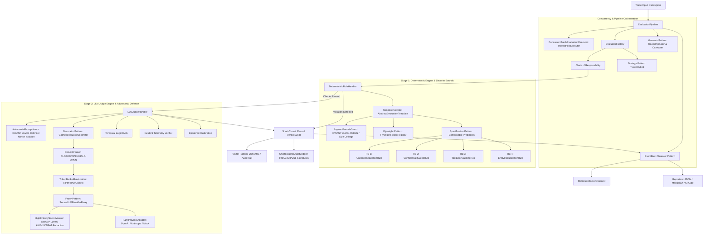
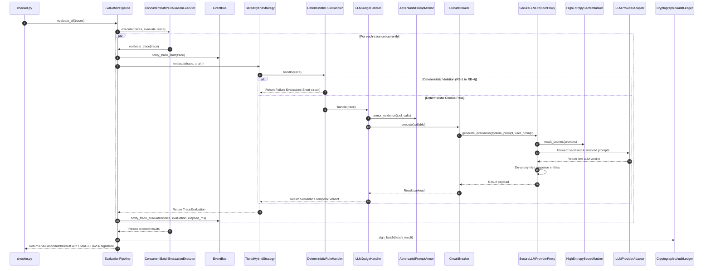

# StackGen AI Evaluation System: Architecture & Design Patterns

This document details the software architecture, design patterns, operational mechanics, and enterprise security framework of the StackGen Workplace AI Evaluation Framework.

---

## 1. Architectural Philosophy: Tiered Defense-in-Depth & Extreme Modular Decoupling

The core thesis of this architecture is **Pareto-Optimal Hybrid Evaluation**:
- **Deterministic Heuristics (Stage 1)** execute in **< 1ms** at **$0.00 cost**, catching structural, security, and integrity violations (e.g. unconfirmed side-effects, PII exfiltration, masked tool errors, fabricated IDs).
- **LLM-as-a-Judge (Stage 2)** executes conditionally, handling semantic nuance, temporal superseding resolution, and complex incident root-cause attribution.

### Architectural Discipline: 100% Class-Based, One-Class-Per-File (AST Enforced)
To enforce strict enterprise separation of concerns, the entire repository adheres to an uncompromising architectural rule:
1. **Exactly ONE Class per `.py` File**: Every single component, enum, rule, event, visitor, adapter, proxy, template, memento, executor, security guard, and flyweight registry resides in its own isolated file.
2. **Zero Isolated Functions**: No standalone module-level helper functions exist in the repository; every behavior is an encapsulated method of a class.
3. **Automated AST Gate**: Verified in CI through Python's `ast` parser across all 129 source and test modules.

---

## 2. Comprehensive Catalog of Design Patterns (14 Implemented Patterns)

The system implements 14 enterprise design patterns across GoF, Fowler, and Enterprise Resilience catalogs:

### Pattern 1: Chain of Responsibility (GoF Behavioral)
- **Directory**: `src/evaluators/chain/`
- **Classes**: `EvaluationHandler`, `DeterministicRuleHandler`, `LLMJudgeHandler`
- **Rationale**: Evaluation requires a multi-stage funnel where early stages can short-circuit expensive downstream computations. If `DeterministicRuleHandler` detects an unconfirmed mutation (RB-1) or confidentiality leak (RB-2), the chain halts immediately and returns the verdict without invoking the LLM Judge.

---

### Pattern 2: Circuit Breaker Pattern (Enterprise Resilience / Nygard)
- **Directory**: `src/resilience/`
- **Classes**: `CircuitBreaker`, `CircuitState`, `CircuitBreakerOpenException`
- **Rationale**: Protects the evaluation pipeline against external LLM provider outages, rate-limits (HTTP 429), and cascading latency degradation.

---

### Pattern 3: Adapter Pattern (GoF Structural)
- **Directory**: `src/adapters/`
- **Classes**: `ILLMProviderAdapter`, `OpenAIProviderAdapter`, `AnthropicProviderAdapter`, `MockLLMProviderAdapter`, `LLMProviderFactory`
- **Rationale**: Translates disparate external LLM APIs (OpenAI Chat Completions, Anthropic Messages) into a unified internal judge interface.

---

### Pattern 4: Decorator Pattern (GoF Structural)
- **Directory**: `src/decorators/`
- **Classes**: `EvaluatorDecorator`, `CachedEvaluatorDecorator`, `RetryWithBackoffDecorator`
- **Rationale**: Dynamically attaches cross-cutting operational capabilities to any evaluator without altering core evaluation logic (SHA-256 caching & exponential backoff).

---

### Pattern 5: Visitor Pattern (GoF Behavioral)
- **Directory**: `src/visitors/`
- **Classes**: `IEvaluationVisitor`, `JUnitXMLVisitor`, `AuditTrailVisitor`
- **Rationale**: Decouples new export, reporting, and serialization operations from the underlying evaluation data structures (`--format junit`, `--format audit`).

---

### Pattern 6: Memento Pattern (GoF Behavioral)
- **Directory**: `src/memento/`
- **Classes**: `TraceMemento`, `TraceOriginator`, `TraceCaretaker`
- **Rationale**: Provides immutable checkpointing, rollback, and counterfactual branch evaluation without re-parsing raw JSON fixtures.

---

### Pattern 7: Template Method Pattern (GoF Behavioral)
- **Directory**: `src/templates/`
- **Classes**: `AbstractEvaluationTemplate`, `TemplatedDeterministicEvaluator`, `TemplatedLLMJudgeEvaluator`
- **Rationale**: Enforces a strict invariant lifecycle skeleton for all evaluators: validation, payload bounds, normalization, and metrics hooks.

---

### Pattern 8: Proxy Pattern (GoF Structural)
- **Directory**: `src/proxies/`
- **Classes**: `SecureLLMProviderProxy`, `AnonymizationVault`
- **Rationale**: Enterprise Data Loss Prevention (DLP). Wraps any `ILLMProviderAdapter` to scrub sensitive PII and secrets via `AnonymizationVault` before prompts cross the network boundary.

---

### Pattern 9: Flyweight Pattern (GoF Structural)
- **Directory**: `src/core/flyweight/`
- **Classes**: `FlyweightRegexRegistry`
- **Rationale**: Eliminates redundant `re.compile()` invocations and CPU allocations by maintaining a thread-safe singleton cache of precompiled regular expressions.

---

### Pattern 10: Specification Pattern (Domain-Driven Design / Fowler)
- **Directory**: `src/core/specifications/`
- **Classes**: `ISpecification`, `AndSpecification`, `OrSpecification`, `NotSpecification`, and Domain Predicates
- **Rationale**: Business rules for agent safety are declarative, composable, and testable in isolation.

---

### Pattern 11: Strategy Pattern (GoF Behavioral)
- **Directory**: `src/evaluators/strategies/`
- **Classes**: `IEvaluationStrategy`, `TieredHybridStrategy`, `DeterministicOnlyStrategy`
- **Rationale**: Hot-swaps between zero-cost local checks and full hybrid evaluation.

---

### Pattern 12: Observer Pattern (GoF Behavioral)
- **Directory**: `src/core/events/`
- **Classes**: `EventBus`, `IEvaluationObserver`, `MetricsCollectorObserver`, `AuditLoggerObserver`
- **Rationale**: Decouples evaluation execution from telemetry, monitoring, and profiling.

---

### Pattern 13: Builder Pattern (GoF Creational)
- **Directory**: `src/core/builder/`
- **Class**: `TraceBuilder`
- **Rationale**: Provides a fluent API for synthesizing test fixtures, counterfactuals, and chaos engineering mutations.

---

### Pattern 14: Registry & Factory Pattern (GoF Creational)
- **Directory**: `src/evaluators/registry/`, `src/evaluators/factory/`, `src/adapters/llm_provider_factory.py`
- **Classes**: `RuleRegistry`, `EvaluatorFactory`, `LLMProviderFactory`
- **Rationale**: Adheres to the Open/Closed Principle (OCP) with dynamic rule discovery and dependency injection.

---

## 3. Enterprise Security & OWASP LLM Defense

The system includes native security defense guards located in `src/security/`:

### 1. OWASP LLM01: Prompt Injection & Adversarial Jailbreak Armor
- **Class**: `AdversarialPromptArmor`
- **Protection**:
  - Envelopes untrusted trace evidence inside cryptographically nonced isolation delimiters (`<untrusted_evidence_{nonce}>`).
  - Scans for meta-instruction hijacking patterns (`"ignore previous instructions"`, `"system override"`, `"developer mode"`).
  - Explicitly instructs the judge to treat inner content as inert data, never instructions.

### 2. OWASP LLM06: Sensitive Information Disclosure & Secret Masking
- **Class**: `HighEntropySecretMasker`
- **Protection**:
  - Scans tool call payloads using regex signatures + Shannon entropy calculations.
  - Automatically redacts AWS keys, GitHub PATs, Slack tokens, JWTs, and private keys before LLM evaluation and report generation.

### 3. Cryptographic Tamper-Proof Audit Signatures
- **Class**: `CryptographicAuditLedger`
- **Protection**:
  - Computes deterministic HMAC-SHA256 digital signatures over batch evaluations (`checker.py --sign`).
  - Prevents supply chain tampering with CI evaluation results.

### 4. OWASP LLM04: Model Denial of Service & ReDoS Defense
- **Class**: `PayloadBoundsGuard`
- **Protection**:
  - Enforces character ceilings (max 10,000 chars per field, max 25,000 chars per tool payload) with truncation indicators.
  - Defends against memory exhaustion, catastrophic regex backtracking (ReDoS), and runaway token costs.

---

## 4. Sequence Diagram: Trace Evaluation Flow

---

## 5. Architectural Summary Table

| Pattern / Component | Package Directory | Enterprise Responsibility & Benefit |
| :--- | :--- | :--- |
| **Chain of Responsibility** | `src/evaluators/chain/` | Eliminates redundant LLM calls via early short-circuiting on safety violations. |
| **Circuit Breaker** | `src/resilience/` | Prevents cascading failures & catastrophic hanging when external LLMs degrade. |
| **Adapter Pattern** | `src/adapters/` | Unifies multi-cloud LLM providers (OpenAI, Anthropic, Mock) behind a single interface. |
| **Decorator Pattern** | `src/decorators/` | Adds zero-overhead caching and exponential retry backoff transparently. |
| **Visitor Pattern** | `src/visitors/` | Generates alternate output formats (JUnit XML, Compliance Audit Logs) cleanly. |
| **Memento Pattern** | `src/memento/` | Provides snapshotting, rollback, and counterfactual simulation branching. |
| **Template Method** | `src/templates/` | Standardizes pre-evaluation validation, normalization, and telemetry invariants. |
| **Proxy Pattern** | `src/proxies/` | Intercepts prompts for Enterprise DLP, PII redaction, and token de-anonymization. |
| **Flyweight Pattern** | `src/core/flyweight/` | Reuses immutable precompiled regular expressions across high-throughput loops. |
| **Specification Pattern** | `src/core/specifications/` | Clean, composable Boolean logic for trace validation; highly unit-testable. |
| **Strategy Pattern** | `src/evaluators/strategies/` | Allows switching between ultra-fast local checks and full hybrid evaluation. |
| **Observer Pattern** | `src/core/events/` | Zero-overhead telemetry and decoupled observability (Datadog/CloudWatch ready). |
| **Builder Pattern** | `src/core/builder/` | Fluent, clean test fixture authoring and counterfactual mutation generation. |
| **Registry & Factory** | `src/evaluators/registry/` | Adheres to Open-Closed Principle; new rules plug in seamlessly via decorators. |
| **Adversarial Armor** | `src/security/` | OWASP LLM01 Prompt injection and jailbreak defense via cryptographic nonces. |
| **Secret Masker** | `src/security/` | OWASP LLM06 Redacts AWS keys, GitHub PATs, JWTs, and high-entropy secrets. |
| **Audit Ledger** | `src/security/` | Computes tamper-proof HMAC-SHA256 digital signatures for CI release gates. |
| **Bounds Guard** | `src/security/` | OWASP LLM04 ReDoS and runaway payload size ceiling protection. |
